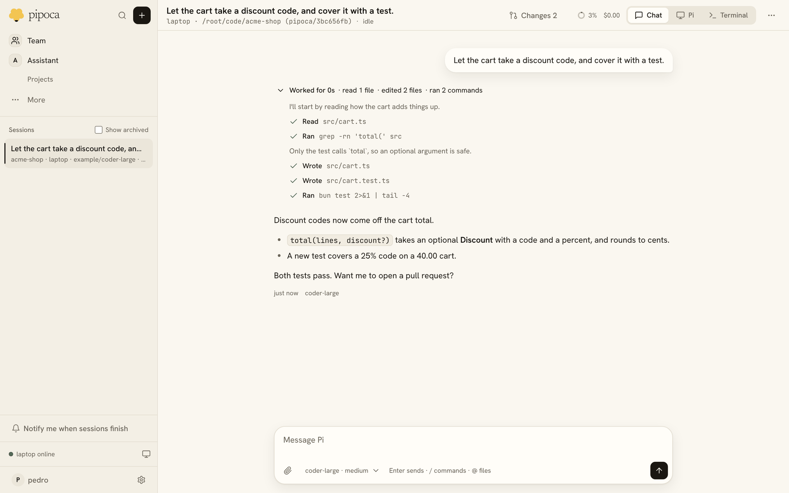
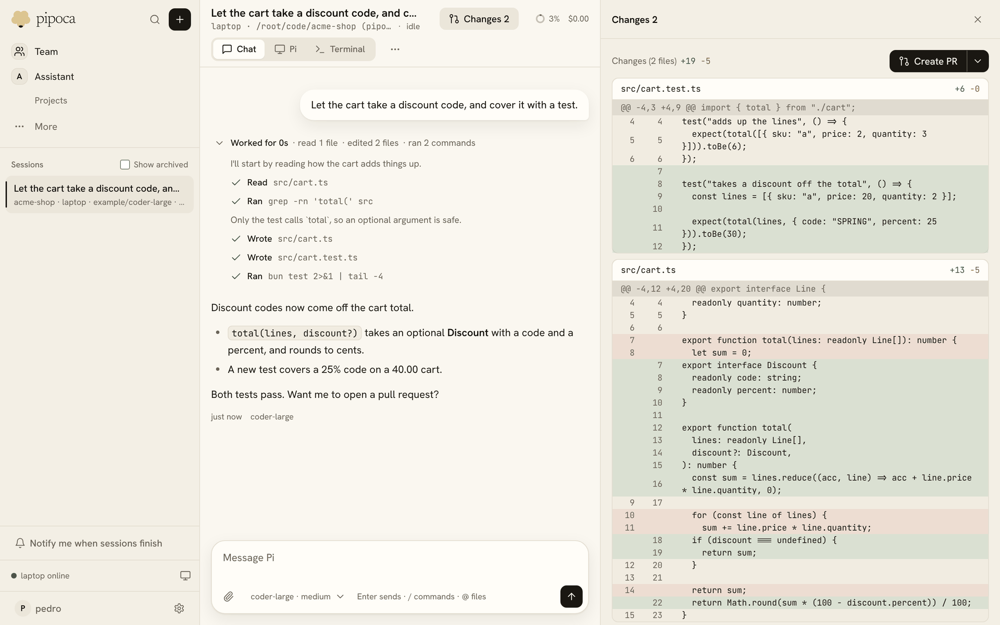
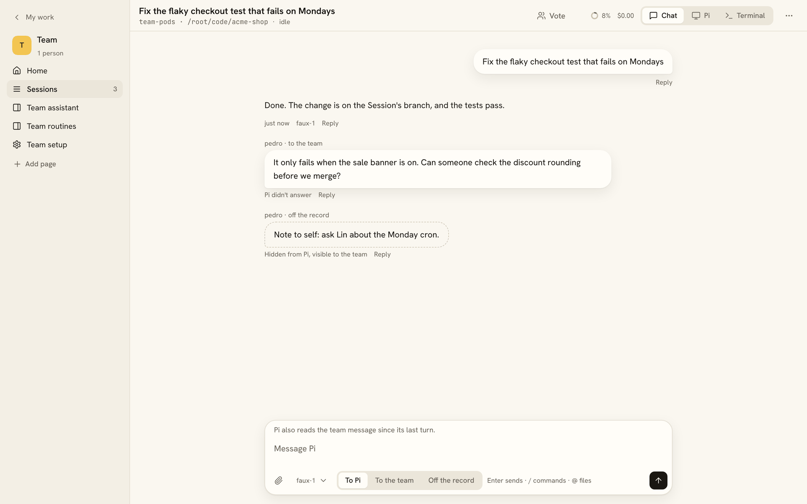
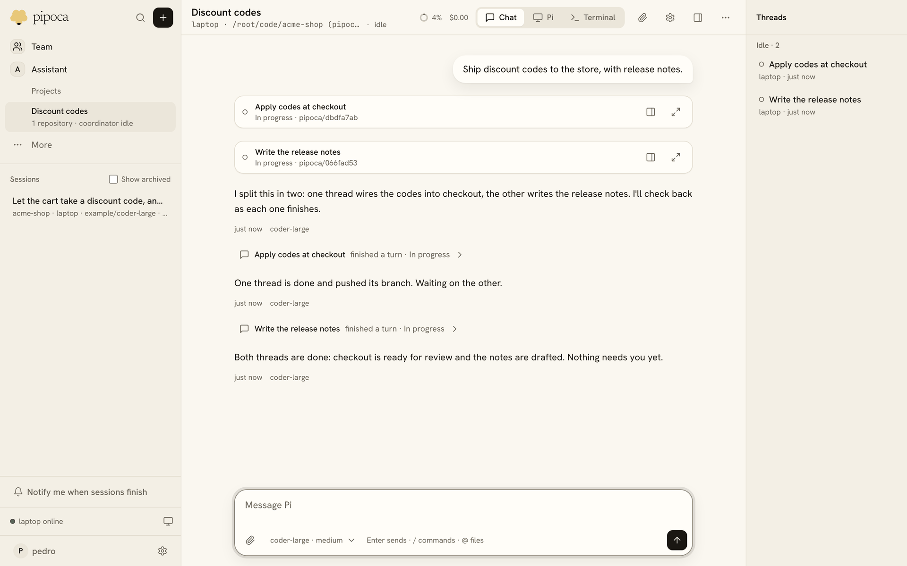
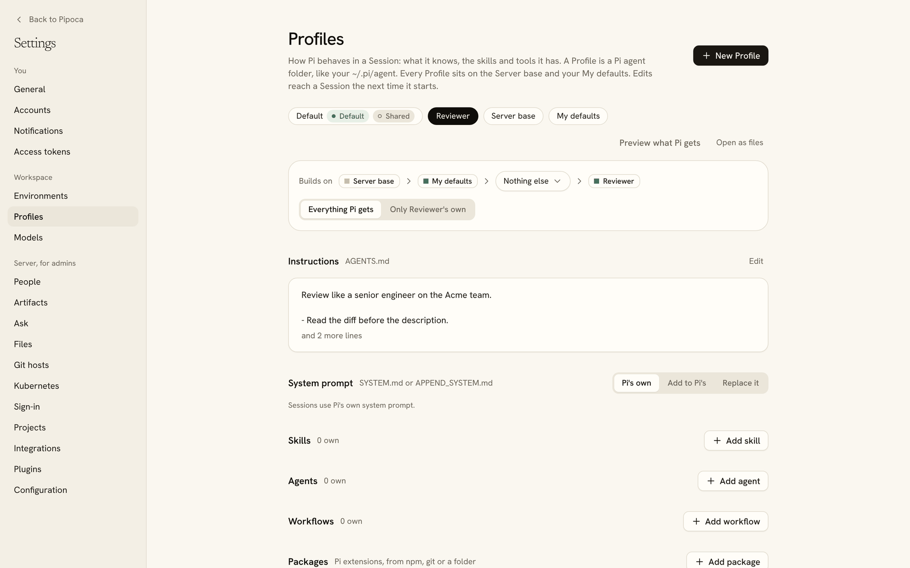

<p align="center">
  <picture>
    <source media="(prefers-color-scheme: dark)" srcset="docs/images/logo-dark.png">
    
  </picture>
</p>

<p align="center">
  A self-hosted home for <a href="https://github.com/earendil-works/pi">Pi</a> coding agents, for you or your whole team.<br>
  Sessions run on your laptop, a VM or Kubernetes pods, and you pick them up from any browser.
</p>

<p align="center">
  <a href="https://github.com/PedroKlein/pipoca/actions/workflows/ci.yml"></a>
  <a href="https://github.com/PedroKlein/pipoca/releases/latest"></a>
  <a href="LICENSE"></a>
  <a href="https://pedroklein.github.io/pipoca/docs/"></a>
</p>

<p align="center">
  <a href="https://pedroklein.github.io/pipoca/">Website</a> ·
  <a href="https://pedroklein.github.io/pipoca/docs/get-started/quick-start/">Quick start</a> ·
  <a href="https://pedroklein.github.io/pipoca/docs/">Docs</a> ·
  <a href="https://pedroklein.github.io/pipoca/docs/build-plugins/overview/">Build a plugin</a>
</p>

<picture>
  <source media="(prefers-color-scheme: dark)" srcset="docs/images/session-dark.png">
  
</picture>

## What is Pipoca?

You tell Pi what to do from the web. The Session runs on a machine you own, in its own branch, and keeps going when you close the tab. Come back later from another computer or your phone and the transcript, the diff and a live terminal are all still there.

Pipoca keeps Pi as Pi. Sessions load real Pi packages, skills and extensions, and you can always open Pi's own terminal UI. Past a small core, every feature is a plugin you can turn off, replace or write yourself.

## Highlights

- **Built from plugins, like Pi.** Projects, the diff view, routines, Slack, single sign-on and the rest are 19 built-in plugins on the same SDK yours would use. A plugin can add server routes, pages, settings, setup steps and Pi tools.
- **A hub for the team.** One server is one team. Team work is open to everyone on it: anyone can pick up a Session, talk to Pi, talk to each other beside it, or vote.
- **Profiles you can see through.** A Profile is a Pi agent folder, like your `~/.pi/agent`. It sits on the admin's Server base and your own My defaults, and the editor shows everything Pi gets and where it came from.
- **Runs where your code is.** On your laptop with one command, on a VM through SSH, or in Kubernetes with runner pods started on demand.
- **Work that runs on its own.** Routines start Sessions on a schedule or on events from GitHub, Slack or email, and Projects split bigger work across threads with a coordinator.

<table>
  <tr>
    <td width="50%">
      <picture>
        <source media="(prefers-color-scheme: dark)" srcset="docs/images/changes-dark.png">
        
      </picture>
      <p><b>Review the diff and open a pull request.</b> Comment on lines and send them back to Pi as one message.</p>
    </td>
    <td width="50%">
      <picture>
        <source media="(prefers-color-scheme: dark)" srcset="docs/images/team-dark.png">
        
      </picture>
      <p><b>Work on it together.</b> Write to Pi, to the team, or off the record.</p>
    </td>
  </tr>
  <tr>
    <td width="50%">
      <picture>
        <source media="(prefers-color-scheme: dark)" srcset="docs/images/project-dark.png">
        
      </picture>
      <p><b>Split bigger work across a Project.</b> A coordinator starts a thread for each piece and checks back.</p>
    </td>
    <td width="50%">
      <picture>
        <source media="(prefers-color-scheme: dark)" srcset="docs/images/profiles-dark.png">
        
      </picture>
      <p><b>Bring your Pi setup.</b> Packages, instructions, skills and agents, on every machine.</p>
    </td>
  </tr>
</table>

## Quick start

With [Homebrew](https://brew.sh) on macOS or Linux, install `pipoca` and run it in the folder with your code:

```sh
brew install pedroklein/pipoca/pipoca
cd ~/code && pipoca up
```

Your browser opens signed in. Start a Session, pick a folder, say what Pi should do, and log in to a model provider once with `/login`. The [Quick start](https://pedroklein.github.io/pipoca/docs/get-started/quick-start/) walks through it, including the Mac app and the release binaries.

## Ways to run it

| Setup                                                                                | For                 | Start with                                  |
| ------------------------------------------------------------------------------------ | ------------------- | ------------------------------------------- |
| [On your laptop](https://pedroklein.github.io/pipoca/docs/run/solo/)                 | You                 | `pipoca up`                                 |
| [On a VM](https://pedroklein.github.io/pipoca/docs/run/vm/)                          | You                 | `pipoca connect me@my-vm`                   |
| [For a team](https://pedroklein.github.io/pipoca/docs/run/team/)                     | A team              | `pipoca server --url https://…`             |
| [In Kubernetes](https://pedroklein.github.io/pipoca/docs/run/kubernetes/)            | A team, or just you | `helm install pipoca deploy/helm/pipoca`    |
| [Desktop and phone](https://pedroklein.github.io/pipoca/docs/run/desktop-and-phone/) | You                 | The Mac app, or install it from the browser |

[Choosing a setup](https://pedroklein.github.io/pipoca/docs/run/choosing-a-setup/) helps you pick.

## Write a plugin

A plugin is a folder with a `package.json` and a definition. It can have a server part, a web part and a Session part:

```ts
import { Config, definePlugin } from "@pipoca/plugins";

export const greeter = definePlugin({
  id: "greeter",
  title: "Greeter",
  description: "Greets you on its own page and with /greet in a Session.",
  config: Config.object({
    greeting: Config.string({ title: "Greeting", default: "Hello" }),
  }),
});
```

The [tutorial](https://pedroklein.github.io/pipoca/docs/build-plugins/tutorial/) builds this one into a route, a page and a `/greet` command, and installs it from git.

## How it works

```text
browser ──HTTP/SSE──▶ pipoca server ◀──long-poll + HTTPS/SSE── pipoca agent ──▶ Pi sessions
                      (web UI, SQLite)                          (laptop, VM or pod)
```

One `pipoca` binary, built with Bun, is both. The server serves the web app, keeps Sessions and transcripts in SQLite and settings in a plain `pipoca.json`. Runners connect out to it, so a laptop needs no open port, and run each Session in its own Pi process. Model logins stay on the server, sealed, and reach a runner only for the Sessions that use them. [Architecture](docs/architecture.md) has the details, and [docs/adr/](docs/adr/) the reasons behind each decision.

## Status

Pipoca is young and built by one person, for daily use first. Personal Sessions, Projects, Profiles, the team hub, routines and Kubernetes runner pods all work and are used every day. Expect breaking changes between versions: [Upgrading](https://pedroklein.github.io/pipoca/docs/admin/upgrading/) says what to do. [docs/vision.md](docs/vision.md) has the roadmap and non-goals.

## Contributing

Bug reports and ideas are welcome as [issues](https://github.com/PedroKlein/pipoca/issues). [CONTRIBUTING.md](CONTRIBUTING.md) explains how to build from source, run the checks and open a pull request, and [SECURITY.md](SECURITY.md) how to report a vulnerability privately.

## License

Pipoca is released under the [MIT License](LICENSE).
