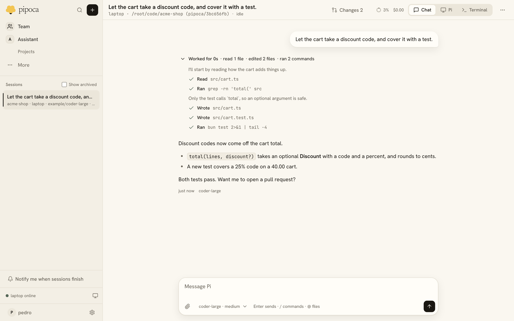
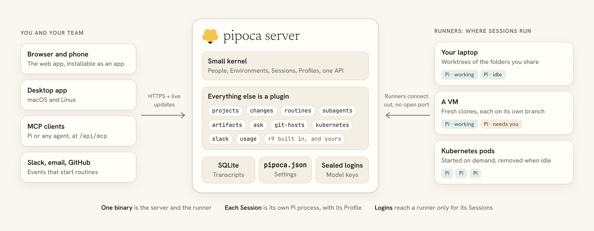

Pipoca is a self-hosted server for the [Pi](https://github.com/earendil-works/pi) coding agent. You type what Pi should do in a browser, pick a folder or paste a repository URL, and Pi works on it in a Session that runs on your laptop, a VM or a Kubernetes pod. The Session keeps going when you close the tab. Open it later from another computer or your phone and the transcript, the diff and a live terminal are still there.

## What you get

- **Sessions that last.** Each Session runs Pi in its own process, in its own Git worktree or clone on its own branch, so several can work in one repository at once. A Session that crashes reloads from its transcript. See [Sessions](../use/sessions.md).
- **Review and pull requests.** The Changes panel shows the diff. Comment on lines and send the comments to Pi, open a pull request, and let the Session fix failing checks and review comments. See [Changes](../use/changes.md).
- **Pi stays Pi.** Sessions load real Pi packages, skills, prompts, extensions and MCP servers from a Profile, and the Pi tab runs Pi's own terminal UI for the same Session. See [Profiles](../use/profiles.md).
- **Bigger work in Projects.** A Project's coordinator splits work across thread Sessions that share memory and a folder of files. See [Projects](../use/projects.md).
- **Work that runs by itself.** Routines start Sessions on a schedule, on events such as a new pull request or a Slack message, or from a webhook. See [Routines](../use/routines.md).
- **A team hub.** On a team server, team Sessions, Projects and routines are open to everyone, people and Pi share one conversation, and admins run the team's Profiles, Environments and model keys, with usage in money. See [Team work](../use/team.md).
- **Plugins all the way down.** Projects, the diff, subagents, routines, single sign-on and Kubernetes runner pods are all plugins on the same SDK you can use. Turn any of them off, install others, or write your own. See [Build plugins](../build-plugins/overview.md).

## How it fits together

One `pipoca` binary is both the server and the runner. The server serves the web UI and the API, keeps people, Sessions and a copy of each transcript in SQLite, and keeps settings in a plain `pipoca.json`. A runner, `pipoca agent`, connects out to the server, so the machine it runs on needs no open port, and runs each Session in its own process. On your own laptop, `pipoca up` does both in one command. [Architecture](../architecture.md) has the details.

## What it isn't

- **Not a hosted service.** Pipoca runs on machines you own or rent, and your code stays there. It reaches model providers with your own logins and keys.
- **Not another agent.** The agent is Pi. Pipoca runs Pi, keeps its Sessions and adds a web UI, Projects, routines and team features around it.
- **Not a Pi replacement.** Profiles are Pi agent folders, packages are Pi packages, and `/login` is Pi's. What works in Pi in a terminal works in a Pipoca Session.

## Status

Pipoca is young and built by one person, for their own daily use first. Personal Sessions and Projects on a laptop and a VM are used every day with real models. Kubernetes, single sign-on, Profiles, the assistant, routines, installed plugins and team work all work. Expect breaking changes between versions: the [upgrading](../admin/upgrading.md) page says what each one needs.

Next: the [quick start](quick-start.md).
