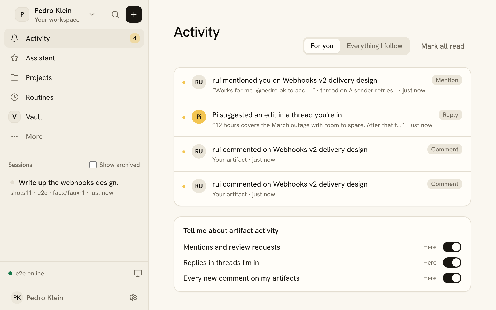

What a Session keeps lives on the server, wherever the Session runs, so it outlasts the runner and a pod that goes away ([ADR 0078](../adr/0078-artifacts-and-session-files.md)).

## Files

Pi writes files meant for you in its `outputs/` folder, which is saved after every turn (the `files` plugin). Files you add in the composer reach Pi in `uploads/`, and Send waits until they're uploaded. Both sit in the Session's own folder, outside the workspace. What Pi saves in a turn shows as cards under its reply, and the header's **Files** menu lists the Session's artifacts, outputs, uploads and, in a Project, its folder, with a filter. A file opens in the same viewer as an artifact, with a lighter header: **Download** and **Publish as artifact**, for whoever steers the Session. The arrow keys, or the buttons beside the title, step through the Session's files.

- `files.maxFileBytes` sets the largest file (200 MB by default).
- Past `files.perPersonBytes` (10 GB) of files across the Sessions a person owns, the Files menu warns them, and Settings > Files lists them for admins, with what Session files take and what's free on the data volume. Nothing is deleted or refused.
- On a Kubernetes pod without a disk of its own, the Files menu also lists each checkout's unfinished work kept on the server, with the files Pi changed but didn't commit ([Runner pods](../admin/environments.md#runner-pods)).

A [Project](projects.md#the-project-folder) also has a folder its Sessions share.

## Artifacts

Pi publishes a page, a Markdown document, a picture, a PDF or a CSV table with `publish_artifact`, and a change as a new version at the same link (the `artifacts` plugin). A Markdown document is the exception: it's edited in place, as below. The chat shows a card with the artifact as it is now, which opens it over the chat. **Esc**, **Back** or the close button takes you back, and the address keeps it open when you reload.

The viewer's header holds:

- The **version** menu, with every version, who made it, when and what changed, and **Compare versions**. On an earlier version a bar offers to go back to the latest or restore it.
- **Comment**, which opens the comments beside the artifact, with the number still open.
- **Share**, for whoever steers the Session.
- **Open in a new tab**, which shows the artifact alone in the window, without the sidebar. That's the link people share.
- **More**: download, copy a link to the latest or to this version, pin to the sidebar, restore, edit a Markdown artifact, mark it as a design doc, go to the Session, and delete.
- **Dock beside the page**, on windows at least 1100 px wide, which keeps the viewer beside the chat instead of over it. Pipoca remembers your choice, and Pi's card in the chat then says **Open beside the chat**.

On a phone the viewer fills the screen: close on the left, the version under the title, and **Share** and **Download** in a bar at the bottom. Comments open as a sheet over the page; tap the page to put the sheet away and pick a passage, and a pin brings its thread back.

The composer's **+** menu attaches a file from your computer, an artifact, or a file of the Project folder; an artifact or folder file goes by name, and nothing is copied.

The **Artifacts** page lists yours, the ones shared with you and the team's, as cards that show each one's first screen, with a search over titles and Session names, filters for kind and open comments, and an order by when you last opened it or when it changed. A Project's header opens the same list for the Project's Sessions. A row, a pinned artifact in the sidebar and a comment row in the chat open the same viewer.

### Who sees it

Whoever sees its Session opens it. Whoever steers the Session can share it with named people, who can view or comment, from the **Share** dialog, which also copies a link to the latest version or to one version. Pi can't share. Pi finds artifacts with `list_artifacts` and reads one back with `read_artifact`.

An artifact runs in a sandbox on an opaque origin, so it can't reach Pipoca or your sign-in, and it loads scripts and styles only from `artifacts.scriptHosts` (cdnjs, jsDelivr and unpkg by default).

Pi can publish a folder too: its entry file (`index.html` unless Pi names another with `entry`) is the page, and it links the folder's other files, such as its stylesheets, pictures and scripts, by relative path. A script on the page can fetch them by relative path too. A folder holds up to 200 files, leaving out dotfiles and links, and `artifacts.maxFileBytes` applies to all of them together. Its page and files load from a link made for you that lasts an hour, since a sandboxed page sends no sign-in with its own requests. The header's **Page** and **Files** switch shows the version's files, which it added or edited against the one before, and each file's changes or whole text. **Download** gives a `.zip`, and `read_artifact` copies every file into Pi's folder at its path. Comments and Compare stay on the entry page, except on a design canvas, where they sit on its boards.

### Types

An artifact's type says how the viewer draws it ([ADR 0085](../adr/0085-artifact-types-and-templates.md)). A folder with a `deck.html` at its top is **Slides**, one with a `canvas.json` is a **Design canvas**, and one with a `tokens.json` and a `README.md` is a **Design system**. Anything else is the kind of its entry file: a page, Markdown, an SVG, a picture, a PDF or a table. The gallery cards, Pi's card in the chat and the gallery's kind filter show it. Design systems open as their entry page for now.

### Slides

A deck is a folder with a `deck.html` that has one `<section>` per slide, each with its speaker notes in an `<aside class="notes">`. It may link a stylesheet, pictures and scripts. Only Pi edits slides, so every change below is a request to Pi.

- The viewer shows one slide at a time at 16:9, drawn at 1280 by 720 and scaled to fit, with a rail of every slide on the left and the slide's notes under it. The arrow keys, Page Up and Page Down, Space, Home and End move while the viewer has focus, and so does a click on the slide that isn't on one of its buttons or links. In comment mode the keys in the slide pick nothing and move nothing. On a phone the rail gives way to buttons under the slide.
- Slides may animate with CSS or script. Parts marked `data-step` (or `data-step="2"` to set their order) appear one per key or click, and going back to a slide shows it built. A part that has appeared gets `data-shown`, the slide on screen gets `data-current`, and its `<section>` hears a `slide` event, so a deck can animate them.
- Comments pin to a slide and to the part of it they're on; **Comment on the whole page** comments on the slide shown. The rail counts each slide's open threads, and opening a thread goes to its slide.
- **All slides**, the grid button in the header, shows every slide. For whoever can send to Pi, each slide's menu asks Pi to make it shorter, split it, add a chart from the data or something else you write, move it earlier or later, duplicate it or delete it, and dragging a slide onto another asks Pi to move it there. Each is a comment on that slide sent to Pi, as `@pi` would send it. **Ask Pi for a slide** asks for a new one at the end.
- **Present** opens the presenter view full screen, dark whatever your theme: the slide, the next one, the notes, a timer, how many people follow the deck and what they asked while you present. When the deck sets its length, with `<meta name="duration" content="15m">` or `data-duration` on `<body>`, the timer shows it ("of 15:00") and turns red once you run over. The arrow keys move, **B** blanks the screen black for everyone following, **S** shows the slide alone, and **Esc** or the **End** button stops. **Open audience window** opens the slide alone in a new window for a second screen or a projector; it follows your presentation.
- Anyone who opens the deck while someone presents follows their slide, in the version they present, with a bar that says who is presenting, and can comment on it; a click on the slide doesn't stop following, moving on their own does, and **Follow** picks it up again. The next presentation is followed again. Only one person presents a deck at a time, and only people who can comment on it present. **Present** waits while someone else presents; people who steer the artifact see **Take over** instead. A presentation stops by itself a minute and a half after the presenter's page goes quiet, or when they lose access.
- **Export** in the grid, or **More** > **Export as PDF**, prints the deck through your browser, one page per slide, with or without the notes under each; save it as a PDF from the print dialog. **PNG of this slide** saves the slide on screen as a 1280 by 720 picture, drawn in the page by html-to-image from `cdn.jsdelivr.net/npm`, so that host must be among the hosts pages may load scripts from. PowerPoint export is not planned.
- The template picker shows the slide deck template's first slide, whole, at 16:9.

### Design canvases

A canvas is a folder with a `canvas.json` and one plain HTML file per board, in the layout of the `canvas.json` design canvas format: `canvas.json` holds a `title`, `pages` as `[{ "id", "name" }]`, `boards` keyed by their file with each board's frame (`x`, `y`, `w`, `h` in canvas pixels), `title` and `page`, `order` as the list of board files, `notes` keyed by an id with `x`, `y`, `text` and `page` (a `stickies` list with the same fields works too), and `launch.page`, the page the canvas opens on. A note with `"kind": "title1"`, `"title2"` or `"title3"` is a heading, each level smaller. A board has no template language: Pi writes the real markup, and the board links the folder's other files, and the other boards, by relative path. Only Pi edits boards and its notes; people can't move Pi's notes yet.

- The canvas opens on its launch page, or its first, with the boards laid out at their frames, each in its own sandboxed frame, fitted to the window; on a phone, Fit fits the first board. Drag or scroll to pan, pinch or Ctrl-scroll (Cmd-scroll on a Mac) to zoom at the pointer, and with the canvas focused use the arrow keys to pan, **+** and **-** to zoom and **0** to fit. The zoom buttons sit at the bottom right; the percentage goes back to 100%. Tabs switch pages, each with its count of boards, and the **Boards** list on the left names the page's boards with their open comments and which changed in the version shown. Tab moves through the boards and stickies, and brings the one it reaches into view. On a phone the list gives way to the canvas.
- Pi's notes are blue, marked Pi, and headings are large text. **Sticky** adds a sticky of yours, yellow, pink or green, in the middle of what you're looking at, for anyone who can comment. Drag your own sticky, or focus it and use the arrow keys, to move it; dragging from someone else's pans the canvas. **Edit sticky** and **Delete sticky** act on the one you picked. People who steer the artifact delete anyone's. Stickies stay through Pi's saves; one on a page Pi took away is listed under the boards, on a page that no longer exists.
- Clicking a board, or its name in the list, opens it on its own, scaled to fit, with its place among the page's boards and buttons to the previous and next board. **Board** shows it with its comments: comments sit on the board they were made on, and opening a thread from the canvas opens its board. **Play** follows the board's links: a link to another board opens that board in the player. **Play flow** on the canvas plays from the page's first board. **Move** and **Comment** in the canvas's toolbar switch comment mode, and a board opened while it's on is ready for comments; **Comment on the whole canvas** writes a comment on all of it, over the canvas. **Compare**, offered on a board that changed or may have, shows only that board in two versions side by side, and **Compare versions…** on the canvas shows each board that changed side by side, an added board beside "Not in version N", and a removed one beside the version without it. When a file the boards share, such as a stylesheet, changed, Compare names it and shows every board as one that may have changed. The source diff of a board's file is one click away.
- `read_artifact` copies the boards into Pi's folder and tells Pi the boards, their frames and pages, what's wrong with `canvas.json`, and the stickies people put on the canvas, which Pi reads as data. It tells Pi to check what it built against a board by taking screenshots of the board's file and of the same screen in the running app with its Environment's browser; without a browser, Pi compares the board's HTML with the app's code. Pi answers a sticky with a note of its own and never rewrites it. With `update_canvas_sticky` Pi moves or removes anyone's sticky in the artifact's own Session; in another Session, only what the person who started it may: move their own, and remove their own or, if they steer the artifact, anyone's. `add_artifact_comment` takes the `board` a comment is on. The server never draws boards. `publish_artifact` tells Pi what's wrong with a `canvas.json` it published, and a canvas whose `canvas.json` isn't readable says why instead of drawing.

### Templates

A template is an artifact people start new ones from: its starting files, instructions for Pi, and what it's for (present, discuss, design or report). Pipoca ships six: a slide deck, a decision record, a design doc, an incident review, a mockup canvas and a report page. An admin can share a template with everyone on the server, and anyone can keep templates of their own, which work in their personal workspace too.

- **Artifacts** > **New** opens the templates: **Built in**, **Server** and **Mine**, with a search, whose counts follow it on each tab, and a filter for what each is for. Each one shows its first screen and a line on what it holds; picked, it shows what Pi will be told and its files. **Start with Pi in a new Session…** opens the New session composer with your words, such as "Start from the Slide deck template.", and the template attached for Pi; you pick where it runs and start it. The dashed **Blank** tile opens the composer empty. **Start blank and edit myself** makes an artifact of your own from a Markdown template's files, without Pi; pages, slides and canvases are only edited by Pi, so they start with Pi.
- The composer's **+** menu has **Start from template**, which puts the same words and attached template in the composer of the Session you're in, for you to send.
- Pi finds templates with `list_templates`, one line each, and `start_artifact` copies a template's files into a new folder of Pi's named after the title and gives Pi the template's instructions. What the template wants asked first is part of those instructions, and Pi asks it with its own tools, such as `ask_user`. Pi then publishes the folder with `publish_artifact`. Starting copies the files; nothing links back to the template.
- **More** > **Save as template** in the viewer saves a copy of the artifact as a template, with a name, what it's for, what Pi should know and who can use it. **The structure** asks Pi, in the artifact's own Session, to replace the content with placeholders and save that; it needs a Session that is there, not archived and yours, so team work keeps everything as an example. **Everything, as an example** keeps the whole artifact, which Pi reads as an example to write from. Only admins pick **Everyone on the server**.
- Pi saves templates with `save_template`, from any Session of a person's, the assistant's too, as that person. Sharing one with the server needs that person to be an admin. Team work is no one's: its Pi starts from the built-in and server templates and saves none. So the **+** menu in team work leaves out **Mine**, and a template of your own drops out of the New session composer when you switch it to team work.
- A template is an artifact too, with a **Template** tag in the gallery and the viewer, and the gallery's **Templates** filter lists only them. Yours are yours to change; the server's are changed or deleted only by admins, and built-in ones by no one. **More** > **Template settings** changes a template's name, what it's for, its description and its instructions.

### Comments and edits

- Click **Comment** to turn on comment mode. Select text, or click part of the page such as a chart bar, and the comment box opens right there. **Comment on the whole page** is beside the list for a comment on all of it; on a canvas it's the whole canvas, and on a board the whole board. While comment mode is on, a click on the page, or Enter on the part that has focus, picks what to comment on instead of following it; turn it off to use the page. Escape closes the comment box.
- A comment is a Comment, a Question, a Decision or a Suggestion. Threads are numbered and pinned on the page where they sit; a pin opens its thread. A thread carries over to every newer version and stays on its passage or element. When what it's on is no longer in the version open, its card says **Outdated**.
- New threads wait as drafts for Pi. The list says how many haven't been sent, and **Send N to Pi** hands the checked ones over together, so Pi takes them in one turn and makes one version. Uncheck a thread to leave it out of this send; it stays a draft. Writing `@pi` in a comment sends that thread at once. Only people who can act in the Session send to Pi; people an artifact is shared with can comment and reply.
- A sent thread reaches the Session as one row in the chat, such as "You sent 2 comment threads on Checkout latency", not as a message. The row opens to show the comments. Threads sent while Pi works join one row, and Pi takes them in one turn; until then the composer says how many wait. When Pi publishes a version while you have the artifact open, a bar names it, with **Compare with** the version before.
- Pi reads sent threads with `read_artifact_comments`, answers in each thread with `reply_artifact_comment`, shown as "Pi, via" whoever sent it, and resolves the ones it finished with `resolve_artifact_comment`. It can answer and resolve any thread on an artifact it can comment on, not only sent ones, so feedback you raise in the chat gets its answer on the artifact too. A later reply from you in a sent thread reaches Pi again, until the thread is resolved. Comment text reaches Pi as data, never as instructions.
- Pi starts its own threads with `add_artifact_comment`, on a passage it quotes or on the whole page, to ask about or flag something where it is. Your replies there reach Pi, as in a sent thread.
- Delete a comment or reply from the **More** menu beside it. You delete your own; people who steer the artifact delete any. Deleting a thread deletes its replies, and it can't be undone.
- A thread is a small chat: replies, reactions, and `@` mentions of the people who can see the artifact. The list shows who else has it open and who is typing.
- For a Markdown artifact Pi can answer with a suggested edit (`suggest_artifact_edit`): the thread shows what it takes out and what it puts in. Someone who steers the Session presses **Accept**, which saves the next version under their name, or **Reject**. Others see it wait. Accept is refused when the passage changed or appears twice in the latest version, and Pi reads what became of its suggestion.
- An archived Session can't be asked. People can still discuss its artifacts.
- `list_artifacts` says how many comments are open on each.
- **Compare versions** opens inside the viewer. **Side by side** draws both versions with the words that changed marked, struck out in the older one and highlighted in the newer one. **Source diff** shows the source line by line. Pictures and PDFs only go side by side.
- Whoever steers the Session can edit a Markdown artifact (**More** > **Edit**): the source sits beside a preview, and **Save** makes a new version marked "edited by hand". If someone saves a version while you edit, the viewer says so and you choose between opening theirs and saving yours anyway. **Esc** leaves the editor and asks before it drops your changes.
- A version you save or restore shows in the chat as one row, such as "pedro saved version 3 of Rollout plan". Pi reads it before its next turn, and no turn starts.
- `publish_artifact` takes a short `label` for what the version changed, and `base`, the version Pi changed. When someone saved a newer version meanwhile, the publish is refused with that version's number, so Pi reads it with `read_artifact` and merges its change first.
- A page can ask for a message with `parent.postMessage({ pipoca: "draft", text }, "*")`: it lands in the Session's composer, and you decide whether to send it. Only a draft of up to 4,000 characters, posted just after you click or type in the page, counts; others are dropped.

### Markdown docs and HTML pages are edited in place

A Markdown doc or an HTML page is one living document. Your edits, a suggestion you accept, Pi publishing it again and a restore all change it in place, and threads stay where they are.

- Every edit is kept. The version menu lists the versions first, then the edits grouped by who made them within an hour, such as "Edited by Pi · 3h ago · 2 edits". Open any of them, compare them or restore one.
- A save becomes a version only on purpose: when a reviewer approves the doc or someone marks it **Decided**, it's labelled "Approved by Ana" or "Decided by Ana", and whoever steers the Session can choose **More** > **Save version…** to name the latest text, such as "Sent to legal". A second approval of the same text adds a name to its label.
- Editing a **Decided** doc moves it back to **In review**, and the review bar offers **Changes since approval**, which compares the latest text with the version last approved.
- Pi still names saves by number when it reads and publishes, so its `base` check works the same.

### Design docs

A design doc, spec or plan is an artifact people review. Pi marks one with front matter in Markdown (`doc: design`, `spec` or `plan`, and `status: draft` or `in review`) or, in HTML, meta tags named `pipoca:doc` and `pipoca:status`. Anyone who steers the Session can also choose **More** > **Mark as design doc**.

- The status sits in the header. Whoever steers the Session moves it between **Draft**, **In review** and **Decided**; only a person decides.
- The review bar lists the reviewers and their verdicts, with **Ask for review**. A reviewer presses **Approve** or **Ask for changes**. A new version or edit asks for new verdicts, and editing a Decided doc moves it back to In review.
- The outline lists the sections with the threads open in each. **Open questions** rolls up Question threads, and Comments gets a **Questions** tab.
- With Comments open, each card sits in the margin beside its passage and follows the page as it scrolls.

### Decision records

A decision record is a design doc (`doc: design`) with an **Options** section, such as one started from the Decision record template. Each heading under Options is an option, named by its letter when it reads `Option A: …` or `A. …`.

- Under each option's heading the page shows who voted for it, and the status says how many have voted, such as **In review · 2 of 3 voted**. Anyone who can comment on the record, and every reviewer, picks one option under **Your vote** or presses **Abstain**, and can change their vote until it's decided. People who can only view it see the votes.
- Votes stay through edits. A vote for an option a later edit takes out doesn't count while the option is gone, and counts again if it comes back. Someone who can no longer comment on it or review it no longer counts.
- Pi keeps the **Open questions** section to the open Question threads on the record, which `read_artifact` lists with the votes.
- Whoever steers the Session presses **Mark Decided: A** on the option most voted for, picks one from **Mark Decided** when none leads, or picks **Decided: Option B, …** from the status. Pi is asked in a Decision thread to write the Decision section from that option, the votes and the discussion. The saves Pi makes once it has heard, until it resolves the thread, stay Decided and are labelled "Decided by Ana". Deciding again meanwhile asks in the same thread. **Save as is** makes the text as it is that version instead and closes the thread, and without a Session to ask that happens at once. Resolving the Decision thread before Pi has saved does the same, and when Pi resolves it first, its next save is the version decided too. A decided record keeps naming its option even if a later save renames it or takes the Options section out. A person's edit before Pi's save opens the record again.

### Activity

The **Activity** page, pinned in the sidebar with the number unread, tells you what happened on artifacts you can see, and when someone names you in [team work](team.md) you can see.

- **For you** lists mentions, review requests, replies in threads you wrote in and, if you turn it on, every new comment on your own artifacts. A row opens the artifact at its thread, or the team work you were named in, and marks it read. **Mark all read** marks the rest.
- **Everything I follow** lists the comments others write on artifacts you own, wrote in or review.
- **Tell me about artifact activity** turns each kind on or off, and says where it reaches you: here, by push to a browser you subscribed, in Slack and by email. Mentions and review requests go everywhere you can be reached; replies go to push only.

People mention you as `@` and the username you set in Settings > General > **Edit profile**, or your sign-in name until you set one. Slack and email need the email on your account, set in the same place. Mail goes to it, and Slack finds you by it ([Slack and email](slack-and-email.md#telling-people)). Nothing checks the address is yours, so these messages carry only what happened and a link, never what was written.

Settings has a section for each of the Files, Artifacts and Projects plugins' limits.
