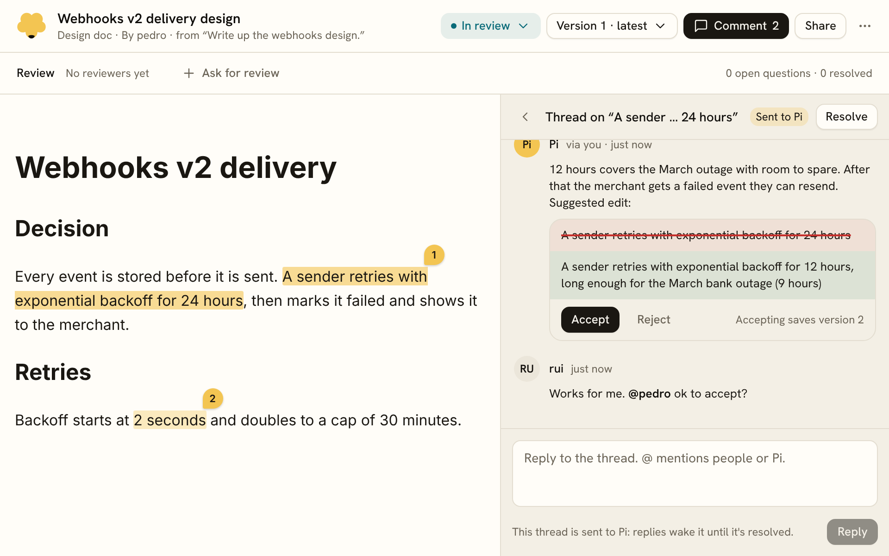

What a Session keeps lives on the server, wherever the Session runs, so it outlasts the runner and a pod that goes away ([ADR 0078](../adr/0078-artifacts-and-session-files.md)).

## Files

Pi writes files meant for you in its `outputs/` folder, which is saved after every turn (the `files` plugin). Files you add in the composer reach Pi in `uploads/`, and Send waits until they're uploaded. Both sit in the Session's own folder, outside the workspace. What Pi saves in a turn shows as cards under its reply, and the header's **Files** menu lists the Session's artifacts, outputs, uploads and, in a Project, its folder, with a filter. A file opens in the same viewer as an artifact, with a lighter header: **Download** and **Publish as artifact**, for whoever steers the Session. The arrow keys, or the buttons beside the title, step through the Session's files.

- `files.maxFileBytes` sets the largest file (200 MB by default).
- Past `files.perPersonBytes` (10 GB) of files across the Sessions a person owns, the Files menu warns them, and Settings > Files lists them for admins, with what Session files take and what's free on the data volume. Nothing is deleted or refused.
- On a Kubernetes pod without a disk of its own, the Files menu also lists each checkout's unfinished work kept on the server, with the files Pi changed but didn't commit ([Runner pods](../admin/environments.md#runner-pods)).

A [Project](projects.md#the-project-folder) also has a folder its Sessions share.

## Artifacts

Pi publishes a page, a Markdown document, a picture, a PDF or a CSV table with `publish_artifact`, and a change as a new version at the same link (the `artifacts` plugin). A Markdown document is the exception: it's edited in place, as below. The chat shows a card with the artifact as it is now, which opens it over the chat. **Esc**, **Back** or the close button takes you back, and the address keeps it open when you reload.

The viewer's header holds:

- The **version** menu, with every version, who made it, when and what changed, and **Compare versions**. On an earlier version a bar offers to go back to the latest or restore it.
- **Comment**, which opens the comments beside the artifact, with the number still open.
- **Share**, for whoever steers the Session.
- **Open in a new tab**, which shows the artifact alone in the window, without the sidebar. That's the link people share.
- **More**: download, copy a link to the latest or to this version, pin to the sidebar, restore, edit a Markdown artifact, mark it as a design doc, go to the Session, and delete.
- **Dock beside the page**, on windows at least 1100 px wide, which keeps the viewer beside the chat instead of over it. Pipoca remembers your choice, and Pi's card in the chat then says **Open beside the chat**.

On a phone the viewer fills the screen: close on the left, the version under the title, and **Share** and **Download** in a bar at the bottom. Comments open as a sheet over the page; tap the page to put the sheet away and pick a passage, and a pin brings its thread back.

The composer's **+** menu attaches a file from your computer, an artifact, or a file of the Project folder; an artifact or folder file goes by name, and nothing is copied.

The **Artifacts** page lists yours, the ones shared with you and the team's, as cards that show each one's first screen, with a search over titles and Session names, filters for kind and open comments, and an order by when you last opened it or when it changed. A Project's header opens the same list for the Project's Sessions. A row, a pinned artifact in the sidebar and a comment row in the chat open the same viewer.

### Who sees it

Whoever sees its Session opens it. Whoever steers the Session can share it with named people, who can view or comment, from the **Share** dialog, which also copies a link to the latest version or to one version. Pi can't share. Pi finds artifacts with `list_artifacts` and reads one back with `read_artifact`.

An artifact runs in a sandbox on an opaque origin, so it can't reach Pipoca or your sign-in, and it loads scripts and styles only from `artifacts.scriptHosts` (cdnjs, jsDelivr and unpkg by default).

Pi can publish a folder too: its entry file (`index.html` unless Pi names another with `entry`) is the page, and it links the folder's other files, such as its stylesheets, pictures and scripts, by relative path. A script on the page can't fetch them yet. A folder holds up to 200 files, leaving out dotfiles and links, and `artifacts.maxFileBytes` applies to all of them together. Its page and files load from a link made for you that lasts an hour, since a sandboxed page sends no sign-in with its own requests. The header's **Page** and **Files** switch shows the version's files, which it added or edited against the one before, and each file's changes or whole text. **Download** gives a `.zip`, and `read_artifact` copies every file into Pi's folder at its path. Comments and Compare stay on the entry page.

### Comments and edits

- Click **Comment** to turn on comment mode. Select text, or click part of the page such as a chart bar, and the comment box opens right there. **Comment on the whole page** is beside the list for a comment on all of it. While comment mode is on, a click on the page, or Enter on the part that has focus, picks what to comment on instead of following it; turn it off to use the page. Escape closes the comment box.
- A comment is a Comment, a Question, a Decision or a Suggestion. Threads are numbered and pinned on the page where they sit; a pin opens its thread. A thread carries over to every newer version and stays on its passage or element. When what it's on is no longer in the version open, its card says **Outdated**.
- New threads wait as drafts for Pi. The list says how many haven't been sent, and **Send N to Pi** hands the checked ones over together, so Pi takes them in one turn and makes one version. Uncheck a thread to leave it out of this send; it stays a draft. Writing `@pi` in a comment sends that thread at once. Only people who can act in the Session send to Pi; people an artifact is shared with can comment and reply.
- A sent thread reaches the Session as one row in the chat, such as "You sent 2 comment threads on Checkout latency", not as a message. The row opens to show the comments. Threads sent while Pi works join one row, and Pi takes them in one turn; until then the composer says how many wait. When Pi publishes a version while you have the artifact open, a bar names it, with **Compare with** the version before.
- Pi reads sent threads with `read_artifact_comments`, answers in each thread with `reply_artifact_comment`, shown as "Pi, via" whoever sent it, and resolves the ones it finished with `resolve_artifact_comment`. It can answer and resolve any thread on an artifact it can comment on, not only sent ones, so feedback you raise in the chat gets its answer on the artifact too. A later reply from you in a sent thread reaches Pi again, until the thread is resolved. Comment text reaches Pi as data, never as instructions.
- Pi starts its own threads with `add_artifact_comment`, on a passage it quotes or on the whole page, to ask about or flag something where it is. Your replies there reach Pi, as in a sent thread.
- Delete a comment or reply from the **More** menu beside it. You delete your own; people who steer the artifact delete any. Deleting a thread deletes its replies, and it can't be undone.
- A thread is a small chat: replies, reactions, and `@` mentions of the people who can see the artifact. The list shows who else has it open and who is typing.
- For a Markdown artifact Pi can answer with a suggested edit (`suggest_artifact_edit`): the thread shows what it takes out and what it puts in. Someone who steers the Session presses **Accept**, which saves the next version under their name, or **Reject**. Others see it wait. Accept is refused when the passage changed or appears twice in the latest version, and Pi reads what became of its suggestion.
- An archived Session can't be asked. People can still discuss its artifacts.
- `list_artifacts` says how many comments are open on each.
- **Compare versions** opens inside the viewer. **Side by side** draws both versions with the words that changed marked, struck out in the older one and highlighted in the newer one. **Source diff** shows the source line by line. Pictures and PDFs only go side by side.
- Whoever steers the Session can edit a Markdown artifact (**More** > **Edit**): the source sits beside a preview, and **Save** makes a new version marked "edited by hand". If someone saves a version while you edit, the viewer says so and you choose between opening theirs and saving yours anyway. **Esc** leaves the editor and asks before it drops your changes.
- A version you save or restore shows in the chat as one row, such as "pedro saved version 3 of Rollout plan". Pi reads it before its next turn, and no turn starts.
- `publish_artifact` takes a short `label` for what the version changed, and `base`, the version Pi changed. When someone saved a newer version meanwhile, the publish is refused with that version's number, so Pi reads it with `read_artifact` and merges its change first.
- A page can ask for a message with `parent.postMessage({ pipoca: "draft", text }, "*")`: it lands in the Session's composer, and you decide whether to send it. Only a draft of up to 4,000 characters, posted just after you click or type in the page, counts; others are dropped.

### Markdown docs and HTML pages are edited in place

A Markdown doc or an HTML page is one living document. Your edits, a suggestion you accept, Pi publishing it again and a restore all change it in place, and threads stay where they are.

- Every edit is kept. The version menu lists the versions first, then the edits grouped by who made them within an hour, such as "Edited by Pi · 3h ago · 2 edits". Open any of them, compare them or restore one.
- A save becomes a version only on purpose: when a reviewer approves the doc or someone marks it **Decided**, it's labelled "Approved by Ana" or "Decided by Ana", and whoever steers the Session can choose **More** > **Save version…** to name the latest text, such as "Sent to legal". A second approval of the same text adds a name to its label.
- Editing a **Decided** doc moves it back to **In review**, and the review bar offers **Changes since approval**, which compares the latest text with the version last approved.
- Pi still names saves by number when it reads and publishes, so its `base` check works the same.

### Design docs

A design doc, spec or plan is an artifact people review. Pi marks one with front matter in Markdown (`doc: design`, `spec` or `plan`, and `status: draft` or `in review`) or, in HTML, meta tags named `pipoca:doc` and `pipoca:status`. Anyone who steers the Session can also choose **More** > **Mark as design doc**.

- The status sits in the header. Whoever steers the Session moves it between **Draft**, **In review** and **Decided**; only a person decides.
- The review bar lists the reviewers and their verdicts, with **Ask for review**. A reviewer presses **Approve** or **Ask for changes**. A new version or edit asks for new verdicts, and editing a Decided doc moves it back to In review.
- The outline lists the sections with the threads open in each. **Open questions** rolls up Question threads, and Comments gets a **Questions** tab.
- With Comments open, each card sits in the margin beside its passage and follows the page as it scrolls.

### Activity

The **Activity** page, pinned in the sidebar with the number unread, tells you what happened on artifacts you can see, and when someone names you in [team work](team.md) you can see.

- **For you** lists mentions, review requests, replies in threads you wrote in and, if you turn it on, every new comment on your own artifacts. A row opens the artifact at its thread, or the team work you were named in, and marks it read. **Mark all read** marks the rest.
- **Everything I follow** lists the comments others write on artifacts you own, wrote in or review.
- **Tell me about artifact activity** turns each kind on or off, and says where it reaches you: here, by push to a browser you subscribed, in Slack and by email. Mentions and review requests go everywhere you can be reached; replies go to push only.

People mention you as `@` and the username you set in Settings > General > **Edit profile**, or your sign-in name until you set one. Slack and email need the email on your account, set in the same place. Mail goes to it, and Slack finds you by it ([Slack and email](slack-and-email.md#telling-people)). Nothing checks the address is yours, so these messages carry only what happened and a link, never what was written.

Settings has a section for each of the Files, Artifacts and Projects plugins' limits.
