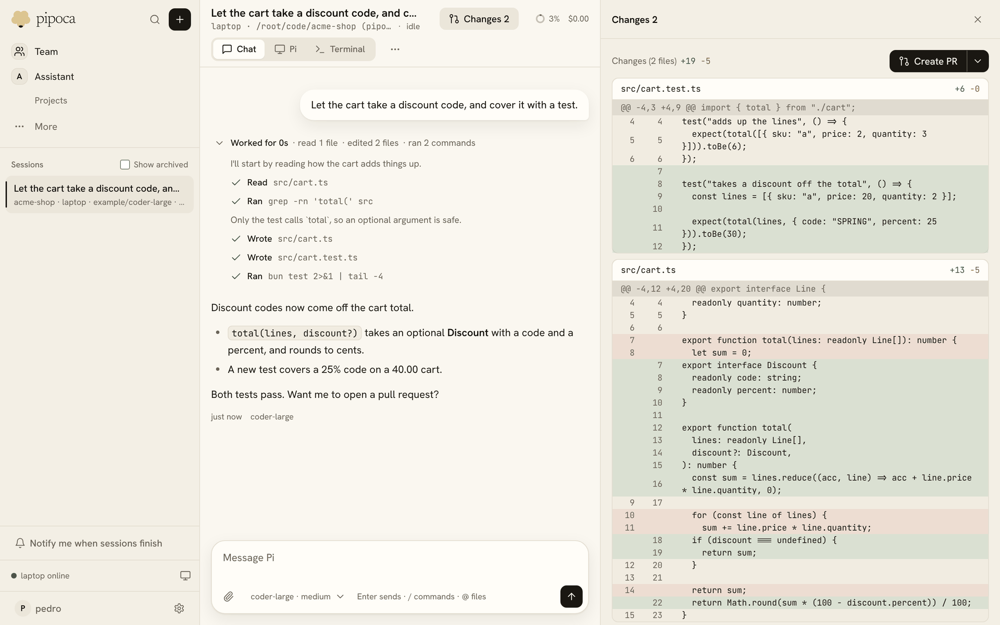

## Review the diff

**Changes**, in a Session's header, opens what the Session changed in its Git workspace, against the commit its branch started from (the `changes` plugin). A Session with several repositories shows each one on its own.

Click a line to leave a comment for Pi. **Send to Pi** sends every comment as one message, with the file and line each one is on, so Pi can work through them in its next turn.

## Open a pull request

**Create PR** commits what the diff shows, pushes the Session's branch, and opens a pull request with a title and description the Session's model writes from the commits and the patch ([ADR 0021](../adr/0021-pull-requests.md)). Its menu also has **Create draft PR**, and **Compose on GitHub**, which pushes and opens GitHub's own form for you to fill in. The same command is `/pr` in the Session, with `draft` or `compose` after it.

Pushing and opening the pull request use the Session's git login: your account on that [git host](../admin/git-hosts.md), or a `GH_TOKEN` secret on the Environment. After that, the panel shows **View PR**.

## Let the Session look after it

The Session that opened a pull request watches it (the `git-hosts` plugin, [ADR 0051](../adr/0051-pull-request-watching.md)). Its row on the Changes panel shows its checks, its review state and whether it conflicts. Its menu has:

- **Auto-fix**: each change becomes a message to the Session: checks that failed, with their names and links; new reviews and review comments from other people; a merge conflict appearing; the pull request merging or closing. The Session makes a clear fix, pushes it to the pull request's branch and says what changed. It asks you before acting on a request that is ambiguous or architectural, and never skips or disables a test to get green.
- **Merge**: merges with the first method the repository allows, in the order squash, merge and rebase.

The server polls each watched pull request with the token of the person who started the Session, about once a minute (the plugin's `pollSeconds`), so it works on GitHub Enterprise with no app or webhook. Watching stops when the pull request merges or closes, or when the Session is archived. To watch a pull request opened some other way, give Pi its URL: the `git_hosts_watch` tool takes it.

In Settings > General, each person chooses:

- **Auto-fix the pull requests my Sessions open**, under Fix my pull requests, on by default. A pull request's own menu turns it off or on for that one.
- **Reply on review threads as me**, off by default. Off, the Session pushes fixes and reports in the chat, and never comments as you. On, it may answer the threads it handled, and each reply ends with a "via Pipoca" line.
