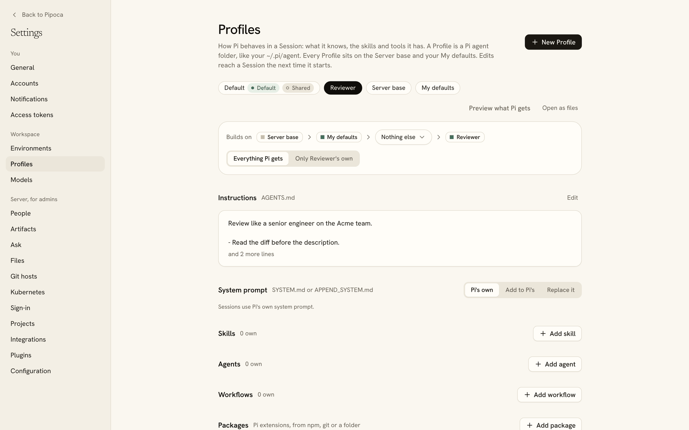

A Profile is a Pi agent folder, like your `~/.pi/agent`: packages, instructions, skills, prompts, extensions, MCP servers and settings, with no credentials ([ADR 0041](../adr/0041-profiles-as-folders.md)). Every Session runs with one, on any machine, so a runner never reads its own `~/.pi/agent`. Settings > Profiles lists yours.

## Make one

- **Import** from a folder, such as your `~/.pi/agent` (logins and Session history stay behind), from an exported `.tar.gz`, or from a git repository that holds a Profile folder.
- **New Profile** starts empty: plain Pi.
- **Ask the assistant** to build one. A thread builds it as a folder in its workspace and installs it once you allow it ([The assistant](assistant.md)).

Then edit it on its page. Each tab is a part of the folder:

| Tab              | What it holds                                                                                                                                |
| ---------------- | -------------------------------------------------------------------------------------------------------------------------------------------- |
| **Overview**     | What the Profile is for and its Pi packages, from npm, git or a folder.                                                                      |
| **Instructions** | `AGENTS.md`, added to Pi's prompt, and `APPEND_SYSTEM.md` or `SYSTEM.md` for Pi's system prompt.                                             |
| **Skills**       | Folders with a `SKILL.md`. `/skill:name` runs one.                                                                                           |
| **Prompts**      | Prompt templates. `prompts/review.md` becomes `/review`.                                                                                     |
| **Extensions**   | TypeScript files or folders that add tools, commands or model providers.                                                                     |
| **MCP**          | MCP servers in `mcp.json`. `${NAME}` in a value reads an Environment secret, and OAuth sign-ins are [logins](../admin/models-and-logins.md). |
| **Models**       | Pi's `models.json`: endpoints that speak an API Pi knows, such as Ollama or a proxy. Keys can name an Environment secret as `$NAME`.         |
| **Settings**     | Pi's `settings.json`, such as `defaultModel` and `defaultThinkingLevel`.                                                                     |
| **Files**        | Every file in the folder, as Pi reads them from `~/.pi/agent`, such as `themes/`.                                                            |

Overview also lists the subagents in `agents/` and the workflows in `workflows/` ([Subagents](subagents.md)).

Settings a Session changes from inside Pi, such as with `/settings`, last until its next start: the Profile on the server is what every start uses.

## Layers

A Session's Profile sits on layers ([ADR 0063](../adr/0063-settings-and-first-run-setup.md#profiles-in-layers), [ADR 0074](../adr/0074-profile-layers-you-can-see-and-turn-off.md)):

1. **Server base**: the admins' Profile under every Session on the server, personal and team ([ADR 0044](../adr/0044-base-profile.md)). Everyone else sees it read-only.
2. **My defaults**: your own layer under all your personal Sessions. Setup's "Make Pi yours" fills it.
3. **The Profiles it builds on**, if any. A Profile can build on another one.
4. **The Profile itself.**

Items from every layer add up, and the nearer layer wins when two have the same name:

| Item                        | From every layer       | Same name in two layers                        |
| --------------------------- | ---------------------- | ---------------------------------------------- |
| Skills, prompts, extensions | All load               | The nearer one replaces it                     |
| Packages                    | All install            | The nearer entry replaces it, filters included |
| MCP servers                 | All connect            | The nearer entry's fields win, as in Pi        |
| `AGENTS.md`                 | Joined, the base first | —                                              |
| `APPEND_SYSTEM.md`          | Joined, the base first | —                                              |
| `SYSTEM.md`                 | Only the nearest one   | The nearer one wins                            |
| Other `settings.json` keys  | Merged key by key      | The nearer value wins                          |
| Other files, such as themes | All copied             | The nearer file wins                           |

Each section of a Profile's page lists everything the Session will get from every layer, labelled with the layer it comes from, and shows whether it's on, off in this Profile, or replacing one from below. **Preview what Pi gets** shows the folder a runner would receive, with each file's source, and downloads it as a `.tar.gz`.

### Turn off what a Profile inherits

A Profile, or My defaults, can turn off any item it inherits, for itself only: a skill, prompt, extension, package or MCP server, or one layer's `AGENTS.md` or `APPEND_SYSTEM.md` text. A package that is off isn't installed. To change an inherited item instead, copy it into the Profile; the copy replaces it, and doesn't follow later changes to the original. Settings such as the default model have no off switch: set a value of the Profile's own, and remove it to go back to the inherited one.

## Shared and team Profiles

- A Profile is yours or shared with everyone from the moment it's made. A shared one is changed only by admins, and an admin can switch a Profile of their own between the two from its page.
- A team Profile belongs to the team and runs team Sessions. Admins manage it, and the server base sits under it, never anyone's My defaults ([Team work](team.md)).

## Profiles from a repository

A repository can share Profiles with a `pipoca.json` at its root that lists them, each a folder of the repository laid out like `~/.pi/agent` ([ADR 0063](../adr/0063-settings-and-first-run-setup.md#repositories-carry-a-manifest)):

```json
{
  "profiles": [
    { "name": "Team review", "path": "profiles/review" },
    { "name": "Team docs", "path": "profiles/docs" }
  ]
}
```

Import a Profile from that repository's https or ssh URL on the Profiles page, pick the ones to bring, and each becomes a Profile of yours that follows its folder. The server clones from a private address only on a host you have a git login for. It checks the repository every 15 minutes (`server.repositorySyncMinutes`), and **Sync now** on the Profile's page checks at once. A synced Profile can't be edited, since the next change in the repository would replace the edit: make a copy of your own, which stops following it, or make a Profile that builds on it. A repository without `pipoca.json` imports as one Profile from its root folder.

This `pipoca.json` is a different file from the server's config file of the same name. It can also list [Environment templates](../admin/environments.md#templates-from-a-repository).
