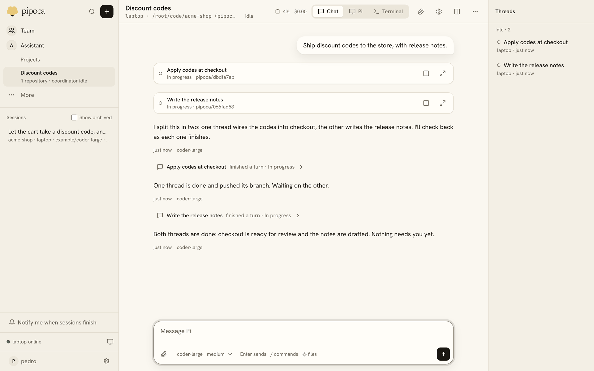

A Project groups work toward one goal across one or more repositories (the `projects` plugin, [ADR 0016](../adr/0016-projects.md), [ADR 0028](../adr/0028-projects-around-the-coordinator.md)). You talk to its coordinator, and it starts a thread Session for each piece of work.

## Start one

Create a Project on the Projects page, under the sidebar's Assistant entry, with a name, a goal, its repositories and an Environment. That starts its coordinator, a Session with every repository checked out.

Tell the coordinator what you want. It starts a thread for each piece of work, gets a turn with a short notice after each thread turn, and shares Project memory with the threads. The Projects page lists the threads with their run and work state, and highlights the ones that need you. You can open any thread and talk to it directly. Threads and the coordinator show only inside their Project.

## Memory

Project memory is a set of files the coordinator and every thread read and write. A memory file that exists changes only on top of the revision a Session last read, so two writers can't lose each other's change.

## A coordinator that doesn't run out of context

When Pi compacts the coordinator's context, a fresh coordinator takes over with a handoff in its system prompt: Pi's summary, the latest messages, the threads and the memory index. **Start fresh** in the Project's settings does the same by hand, and the settings list each earlier conversation ([ADR 0052](../adr/0052-the-assistant-as-a-project.md#coordinators-are-swapped-not-compacted)).

## The Project folder

Each Project has a folder of files shared by its Sessions, which each see it as a `project/` folder outside their workspace ([ADR 0078](../adr/0078-artifacts-and-session-files.md)).

- A Session pulls others' changes in the background as a turn starts and sends its own after the turn.
- When two Sessions change one file, the later one is kept beside it as `name (from <thread>).ext`. A conflict copy shows a badge and opens side by side with the file it was saved beside.
- The folder button on the Project's page uploads, downloads and removes files, opens subfolders, searches the folder, makes new folders and lists recent writes, with who last wrote each file.
- Earlier versions stay downloadable for `projects.folderHistoryDays` (30 by default), and a file can be up to `projects.maxFileBytes` (200 MB).
- Past `projects.perProjectBytes` (5 GB), its people get a warning. Nothing is deleted or refused.
- Pi finds files by words in their paths with `list_project_files`.

## Who sees it

A Project, its threads and its folder belong to the person who started it. A team Project belongs to the team, runs on team Profiles and Environments, and is open to the team like any team work ([Team work](team.md)).
